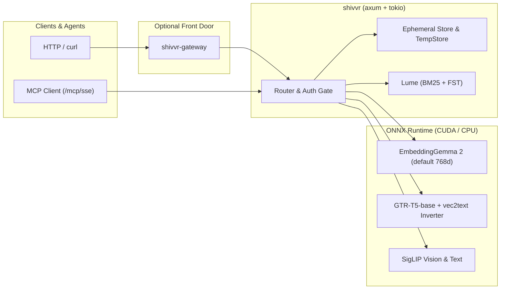

<div align="center">


# shivvr

**Ephemeral semantic memory and multimodal embeddings in one container.**

[](https://github.com/DeepBlueDynamics/shivvr/actions/workflows/release.yml)
[](LICENSE)
[](https://www.rust-lang.org/)
[](https://hub.docker.com/r/deepbluedynamics/shivvr)
[](#mcp--agent-chat)

[Quick start](#quick-start) · [Images](#images) · [Features](#features) · [Architecture](#architecture)

</div>

---

Agents and edge applications constantly need to chunk documents, embed text or media, search recent context, and hand results back over HTTP or MCP — without standing up a permanent vector database or leaving sensitive session transcripts behind on disk.

**shivvr** is an in-memory semantic embedding and retrieval service written in Rust on top of ONNX Runtime. It chunks incoming text on sentence boundaries, embeds it with **EmbeddingGemma 2** (the 768d default, with Matryoshka truncation down to 128d) or **GTR-T5-base** (kept alongside every chunk so it can be inverted back to text), embeds images with **SigLIP** until EmbeddingGemma 2's own image path is served ([roadmap](plan/ROADMAP.md)), fuses dense cosine similarity with **BM25** lexical search ([Lume](https://github.com/DeepBlueDynamics/lume)), and serves everything from ephemeral in-process memory.

*What did this session just read, hear, or see — and how do we search it without leaving a trace on disk?*

### Built for places where the cloud is optional

Where a GPU is available, `deepbluedynamics/shivvr:latest` ships CUDA 12.6 with every fp32 model baked into the image. On small machines and at the edge — including a Raspberry Pi 5 running HaLOS — `deepbluedynamics/shivvr:latest-cpu` pairs with a 440 MB `int8` model volume (`deepbluedynamics/shivvr-models:int8`) to serve EmbeddingGemma 2 and GTR-T5-base in ~820 MiB of RAM ([`deploy/halos/`](deploy/halos/README.md)).

An open source project from [DeepBlue Dynamics](https://github.com/deepbluedynamics/),
which builds open source agentic tooling for the marine electronics market.
DeepBlue's promise: agents and people can ask questions of a boat's instruments,
logs and documents, on board and without a connection.

## Highlights

- **EmbeddingGemma 2 default (768d, Matryoshka 512/256/128):** serves `POST /embed`, session ingest (`document` prefix), and search (`query` prefix) out of the box, with 19 task prefixes.
- **GTR-T5-base alongside:** every chunk also keeps a GTR vector (returned with `"return_vectors": ["gtr-t5-base"]`) so `/invert` works on any session; choose `model: "gtr-t5-base"` to make GTR a store's search model too.
- **SigLIP for images, for now:** `/image/embed` and `siglip-base-patch16-224` text vectors share one space for text-to-image search. EmbeddingGemma 2's own vision path replaces SigLIP once it's served (roadmap M4).
- **Hybrid BM25 + vector search:** combines SIMD cosine similarity with [Lume](https://github.com/DeepBlueDynamics/lume)'s stemmed BM25 (MaxScore-pruned) in rank fusion, temporal recency decay, nearby-chunk context windows, and microsecond FST query guardrails.
- **Ephemeral by design:** all sessions and 2-hour TTL named scratchpads (`/temp/:name`) live in process memory (`RwLock<HashMap>`) — restarting the container leaves a clean slate.
- **Vec2text inversion (`/invert`):** reconstructs approximate text from 768d GTR-T5-base embeddings using an ONNX projection + T5 encoder/decoder loop.
- **Per-agent orthogonal encryption:** multiplies vectors by an agent's registered orthogonal matrix (`v @ Q`), preserving exact cosine similarity while keeping embeddings opaque.
- **GPU and multi-arch CPU images:** runs on `linux/amd64` with CUDA 12.6 or on `linux/amd64` and `linux/arm64` CPU with quantized `int8` models.
- **Native MCP server & `nuts-auth`:** exposes memory tools over `/mcp/sse` + `/mcp/message` and supports optional RS256 JWT and `ahp_` API token verification.

## Quick start

### CPU (amd64 or arm64, including Raspberry Pi 5)

1. Create a volume for the models:

   ```bash
   docker volume create shivvr-models
   ```

2. Copy the int8 models (EmbeddingGemma 2 + GTR-T5-base, 440 MB) into it. This container fills
   `/target` with the model files, replacing whatever is there, and exits:

   ```bash
   docker run --rm -v shivvr-models:/target deepbluedynamics/shivvr-models:int8
   ```

3. Start shivvr with the volume mounted read-only at `/models`:

   ```bash
   docker run -d --name shivvr -p 127.0.0.1:8080:8080 -v shivvr-models:/models:ro deepbluedynamics/shivvr:latest-cpu
   ```

To keep the models in a folder on the host instead, use a new, empty folder in both commands, since
step 2 replaces its contents:

```bash
mkdir shivvr-models
docker run --rm -v "$PWD/shivvr-models:/target" deepbluedynamics/shivvr-models:int8
docker run -d --name shivvr -p 127.0.0.1:8080:8080 -v "$PWD/shivvr-models:/models:ro" deepbluedynamics/shivvr:latest-cpu
```

### GPU (amd64, NVIDIA driver 545+ and the [NVIDIA Container Toolkit](docs/BUILDING.md#1-host-gpu-setup-for-cuda-builds--containers))

All models are in the image (about a 4.4 GB pull), so there's nothing to mount. Setting
`LD_LIBRARY_PATH` makes ONNX Runtime use your host's NVIDIA driver; use this on Docker Desktop for
Windows (WSL2) and with driver 560 or newer:

```bash
docker run -d --name shivvr --gpus all -p 127.0.0.1:8080:8080 -e LD_LIBRARY_PATH=/usr/lib/onnxruntime deepbluedynamics/shivvr
```

Leave it out on a Linux host with driver 545–559; the image then uses the CUDA 12.6 compatibility
library it ships. `docker logs shivvr` shows `Creating BFCArena for Cuda` when the GPU is in use and
`falling back to CPU` when it isn't.

### Try it

`/health` answers once the models are loaded (up to 60 s on first start). Then ingest, search and embed:

```bash
curl -s http://localhost:8080/health

curl -s -X POST http://localhost:8080/sessions/demo/ingest -H "Content-Type: application/json" \
  -d '{"text": "The harbor was quiet at dawn. Only the sound of halyards against aluminum masts."}'

curl -s "http://localhost:8080/sessions/demo/search?q=morning+at+the+marina&n=3"

curl -s -X POST http://localhost:8080/embed -H "Content-Type: application/json" \
  -d '{"texts": ["waterproof trail shoes"], "model": "embeddinggemma-2", "task": "query", "dimensions": 256}'
```

*(In Windows PowerShell, use `curl.exe` instead of the `curl` alias and escape inner double quotes or pipe a single-quoted JSON string).*

That's it. No authentication is required unless `NUTS_AUTH_JWKS_URL` is set, and nothing is written to disk. The CPU int8 set holds EmbeddingGemma 2 and GTR-T5-base only: for `/image/embed`, SigLIP text vectors or `/invert` on CPU, mount the full fp32 model set (see [docs/BUILDING.md](docs/BUILDING.md)) or use the GPU image.

## Images

| Image | Tags | Platforms | Models included |
|---|---|---|---|
| `deepbluedynamics/shivvr` | `latest`, `X.Y.Z`, `vX.Y.Z` | `linux/amd64` (CUDA 12.6) | Baked in (fp32): EmbeddingGemma 2, GTR-T5-base, SigLIP vision + text, vec2text inverter |
| `deepbluedynamics/shivvr` | `latest-cpu`, `X.Y.Z-cpu`, `vX.Y.Z-cpu` | `linux/amd64`, `linux/arm64` | None baked in — mount `/models` from `shivvr-models:int8` or local `models/` |
| `deepbluedynamics/shivvr-models` | `int8` | `linux/amd64`, `linux/arm64` | One-shot volume installer (440 MB `int8`): EmbeddingGemma 2 text + GTR-T5-base |
| `deepbluedynamics/shivvr-gateway` | `latest`, `X.Y.Z`, `vX.Y.Z` | `linux/amd64` | None — GPU-less front door (landing page, `nuts-auth` check, proxy to backend) |

## Features

Full endpoint schemas, parameters, and examples are in [**docs/API.md**](docs/API.md), and environment variables are in [**docs/CONFIGURATION.md**](docs/CONFIGURATION.md).

### Embed (`/embed`, `/image/embed`, `/audio/*`)
`POST /embed` returns batched unit vectors without touching session state: `embeddinggemma-2` (default, 768d or Matryoshka `512`/`256`/`128` with `task` prefixes), `gtr-t5-base` (768d), or `siglip-base-patch16-224` (768d text tower in the same space as `POST /image/embed`). `POST /audio/transcribe` and `POST /audio/embed` transcribe audio via `TRANSCRIPTION_URL`. See [docs/API.md#embed-post-embed-imageembed-audio](docs/API.md#embed-post-embed-imageembed-audio).

### Sessions & search (`/sessions/:id/*`)
`POST /sessions/:id/ingest` splits text into sentence-bounded chunks and embeds them (`embeddinggemma-2` with its `document` prefix by default, or `gtr-t5-base` when `"model": "gtr-t5-base"` is passed on the first ingest). `GET /sessions/:id/search` runs cosine similarity (`query` prefix on EmbeddingGemma 2), optional BM25 `hybrid=true` or `lexical_only=true`, temporal decay, and FST guardrails. See [docs/API.md#ingest-post-sessionsidingest--post-tempnameingest](docs/API.md#ingest-post-sessionsidingest--post-tempnameingest).

### Temp stores (`/temp/:name/*`)
Named ephemeral stores with an automatic 2-hour TTL (`/temp`, `/temp/:name/ingest`, `/temp/:name/search`, `/temp/:name/dump`, `DELETE /temp/:name`). Like sessions, a temp store locks in its embedding model on first ingest. See [docs/API.md#temp-store](docs/API.md#temp-store).

### Inversion (`/invert`)
`POST /invert` reconstructs approximate text from a 768d **`gtr-t5-base`** vector and returns `{"text", "similarity"}`. GTR runs alongside the default model: every text chunk keeps a GTR vector, returned when you ingest with `"return_vectors": ["gtr-t5-base"]`. For new text, call `/embed` with `"model": "gtr-t5-base"`. See [docs/API.md#inversion-post-invert](docs/API.md#inversion-post-invert).

### Encryption (`/agent/:id/*`)
Register a per-agent orthogonal rotation matrix (`POST /agent/:id/register`) to encrypt chunk embeddings at ingest and query vectors at search time, or call `/agent/:id/encrypt` and `/agent/:id/decrypt` directly. See [docs/API.md#per-agent-encryption-agentid](docs/API.md#per-agent-encryption-agentid).

### MCP & agent chat (`/mcp/*`, `/sessions/:id/agent/chat`)
Connect any MCP client to `GET /mcp/sse` (`search_memory`, `ingest_memory`, `list_sessions`), or stream turn-based GhostAgent reasoning over a session with `POST /sessions/:id/agent/chat`. See [docs/API.md#mcp-server--ghostagent-chat](docs/API.md#mcp-server--ghostagent-chat).

### Auth (`nuts-auth`)
Set `NUTS_AUTH_JWKS_URL` to verify RS256 JWTs (`Authorization: Bearer <jwt>`) and API tokens (`Authorization: Bearer ahp_<token>`). Leave it unset for open local development. See [docs/API.md#auth](docs/API.md#auth).

## Architecture



## Build from source

Building the Rust binary from source, exporting fp32 ONNX models (`scripts/fetch_models.sh`, `scripts/export_siglip.py`, `scripts/export_embeddinggemma2.py`), and quantizing the `int8` model set (`scripts/quantize_models.py`) are covered in [**docs/BUILDING.md**](docs/BUILDING.md). Maintainers cut a release with `bash scripts/bump-version.sh`, then push the tag (see [**docs/OPERATIONS.md**](docs/OPERATIONS.md)).

## Development

```bash
cargo test --lib --no-default-features          # fast unit tests (no ONNX models needed)
cargo test --no-default-features --bin gateway  # gateway auth & proxy tests
cargo test                                      # full unit + integration tests
python tests/functional.py http://localhost:8080
```

### Repository layout

| Path | Contents |
|---|---|
| `src/` | The `shivvr` library and service binary: API router, embedders, chunker, store, crypto, inverter, MCP, GhostAgent |
| `src/bin/gateway.rs` | Lightweight `shivvr-gateway` front-door binary (landing page, `nuts-auth` verification, Cloud Run proxy) |
| `scripts/` | Model exporters (`export_embeddinggemma2.py`, `export_gtr_models.py`, `export_siglip.py`), `quantize_models.py`, `bump-version.sh` |
| `deploy/halos/` | HaLOS Marine container app definition for Raspberry Pi 5 (`docker-compose.yml`, `config.yml`, `metadata.json`) |
| `tests/` | Rust integration tests (`tests/integration.rs`) and Python end-to-end functional suite (`tests/functional.py`) |
| `training/` | Standalone Python `vec2text` hypothesis + corrector training pipeline |
| `plan/` | Active engineering plans (`plan/EMBEDDINGGEMMA2_PLAN.md`) and archived design notes (`plan/archive/`) |
| `docs/` | [API.md](docs/API.md), [CONFIGURATION.md](docs/CONFIGURATION.md), [BUILDING.md](docs/BUILDING.md), and [OPERATIONS.md](docs/OPERATIONS.md) |

## Roadmap

- **EmbeddingGemma 2 image and audio encoders:** native image (`/image/embed`) and direct audio (`/audio/embed`) soft-token pipelines (`plan/EMBEDDINGGEMMA2_PLAN.md`, WP3 & WP4).
- **In-domain retrieval benchmarks & fine-tuning:** evaluation harness across Matryoshka dimensions (`768`/`256`/`128`) and `int8` vs `fp32` on marine and agent corpora.
- **HaLOS Raspberry Pi 5 packaging:** on-device latency/thermal benchmarks and submission of `deploy/halos/shivvr` to `halos-marine-containers`.

## License

[BSD 3-Clause](LICENSE). Copyright © 2026 DeepBlue Dynamics LLC.

## Credits

Built by [DeepBlue Dynamics](https://github.com/deepbluedynamics/) on top of [EmbeddingGemma 2](https://huggingface.co/google/embeddinggemma-2) and [SigLIP](https://huggingface.co/google/siglip-base-patch16-224) (Google), [GTR-T5-base](https://huggingface.co/sentence-transformers/gtr-t5-base) (Sentence Transformers), [vec2text](https://github.com/jxmorris12/vec2text) (Morris et al.), and [ONNX Runtime](https://onnxruntime.ai/) via [`ort`](https://ort.pyke.io/).
